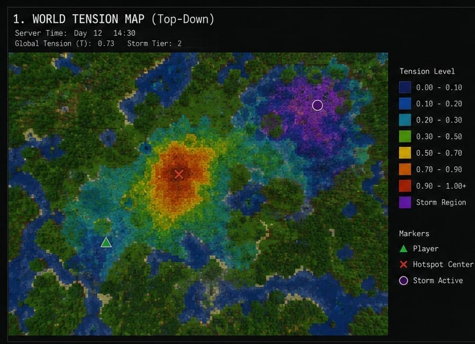

# UTD Mod — Unified Tension Dynamics

**Minecraft 1.20.4** • **Fabric** • **Java 17** • **Research Prototype**

A server-authoritative substrate simulation for Minecraft that enables the world to accumulate memory, organize into persistent spatial regions, and evolve in response to player activity.

Unlike conventional sandbox mechanics that respond only to the current game state, UTD introduces a persistent dynamical field distributed across chunks. Every meaningful player action perturbs this field. Over time those perturbations accumulate into long-lived spatial structure that can influence gameplay through ecology, weather, entities, resources, and presentation.

The project combines a nonlinear substrate simulation, a gameplay interpretation layer, and a complete telemetry pipeline for analysing the behaviour of the field inside a live Minecraft world.

For the theoretical foundation see:

**Substrate X — Theory of Information Gravity**

https://github.com/brayo003/Substrate-X-Theory-of-Information-Gravity

<p align="center">
  
</p>

---

## Motivation

Sandbox worlds typically respond only to immediate player actions. Once an event has ended, the world rapidly returns to its previous state.

UTD Mod investigates an alternative approach: treating the world as a persistent dynamical system whose internal state evolves continuously over time. Rather than scripting behaviours directly, gameplay systems derive their behaviour from an underlying substrate that accumulates memory, develops spatial organisation, and retains the effects of historical activity.

Minecraft serves as the initial implementation and experimental environment for the substrate architecture.

---

## Substrate Model

Each active chunk stores four coupled state variables.

| Variable | Purpose |
|----------|---------|
| **Activation (A)** | Short-term excitation produced by player activity. |
| **Memory (M)** | Persistent history of sustained activation. |
| **Depth (D)** | Long-term structural consolidation of disturbance. |
| **Baseline (B)** | Slowly adapting equilibrium state. |

From these variables several observables are derived:

- Local tension **T(x)**
- Readiness **R**
- Region maturity
- Global field statistics
- Storm and corruption metrics

These variables evolve together as one coupled nonlinear dynamical system rather than a collection of independent gameplay counters.

---

## Dynamical Model

Every five server ticks the substrate integrates the coupled state variables for every active chunk.

The implementation includes:

- nonlinear activation dynamics
- thresholded memory formation
- logistic saturation
- depth-dependent retention
- inter-chunk transport
- spatial diffusion
- anti-diffusion sharpening
- adaptive baseline evolution

Higher-level gameplay systems are derived from these evolving fields rather than driving them directly.

Complete equations, parameters and implementation details are documented in:

- `docs/architecture_audit/EQUATIONS.md`
- `docs/architecture_audit/PARAMETER_CATALOG.md`

---

## Architecture

```text
Player Actions
        │
        ▼
   Perturbations
        │
        ▼
Substrate Dynamics
   (A, M, D, B)
        │
        ▼
     Regions
        │
        ▼
 Interpretation
        │
        ▼
Gameplay Systems
```

The runtime pipeline executes on the server thread through a single `END_SERVER_TICK` handler.

```text
Player action
(mining / movement / combat / ritual)
        │
        ▼
Perturbation injection
addInstantaneousImpulse(chunk, amount)
[ChunkTensionManager / TensionEvents]
        │
        ▼
Chunk substrate integration (every 5 ticks)
integrateAllSubstrateStates()
FieldDerivative.computeUnified(...)
SubstrateTransport.computeIncoming(...)
[ChunkTensionData]
        │
        ▼
Interpretation layer
SubstrateInterpretationEngine
RegionalWeatherCoordinator
WorldPresentationState
        │
        ▼
Gameplay actuators
Weather
Ecology
Resources
Mobs
Villages
Particles
        │
        ▼
Chunk classification
STABLE / STRAINED / FRACTURED / DECOUPLED
        │
        ▼
Region reconstruction (every 20 ticks)
        │
        ▼
Global metric aggregation
        │
        ▼
Ecology updates
        │
        ▼
Client synchronisation
TensionSyncPacket → TensionSyncState
```

The server is authoritative. Clients never simulate the substrate. They render a synchronised snapshot received from the server for HUD, presentation, audio and visual feedback.

---

## Implemented Systems

### Simulation

- Persistent four-state substrate (A, M, D, B)
- Coupled nonlinear field integration
- Inter-chunk transport
- Region reconstruction
- Persistent save/load support

### Gameplay Integration

- Ecology mutations
- Weather coupling
- Spawn modifiers
- Loot modifiers
- Villager behaviour modifiers
- Interpretation layer connecting substrate state to gameplay systems

### Research Infrastructure

- Complete JSONL telemetry pipeline
- Automated experiment player
- Region statistics
- Time-series analysis
- Python analysis toolkit
- Parameter experimentation framework

---

## Experimental Validation

Four controlled Minecraft server experiments were analysed using the integrated telemetry pipeline (42,071 ticks and 67,279 substrate snapshots).

The complete report is available in:

`analysis/UTD_TELEMETRY_REPORT.md`

Key findings supported by measured telemetry:

- **Bistability confirmed.** Small perturbations decay naturally, while sufficiently large perturbations move the substrate into a distinct stable attractor. This provides a mechanism for persistent progression without scripted state machines.
- **Hysteresis confirmed.** After 25,786 ticks of zero external input following a large perturbation run, the field remained in the non-trivial attractor rather than returning to baseline.
- **Autonomous organisation.** Transport variability decreased from 0.73 during externally driven activity to 0.045 during relaxation, indicating self-organised internal dynamics without direct player input.
- **Stable spatial topology.** Four regions persisted throughout the relaxation experiment with no births, merges, splits or deletions.
- **Temporal scale hierarchy.** Activation evolves over ticks, memory over hundreds of ticks and depth over thousands of ticks, producing layered temporal behaviour suitable for long-term gameplay systems.

Known implementation investigations are documented in:

`docs/SUBSTRATE_AUDIT.md`

---

## Why this Architecture?

Traditional sandbox mechanics typically rely on scripted triggers, timers and handcrafted event logic.

UTD separates simulation from gameplay.

The substrate evolves continuously according to its own state equations. Gameplay systems observe the evolving field and translate its current state into world behaviour. Multiple gameplay systems therefore share the same underlying world state while remaining loosely coupled.

---

## Research Questions

This project investigates whether a persistent nonlinear substrate can:

- produce stable long-term spatial organisation
- retain memory across gameplay sessions
- generate emergent regional behaviour
- support gameplay through continuous dynamics rather than scripted events
- remain computationally practical inside a real-time sandbox game

---

## Repository Layout

| Directory | Purpose |
|-----------|---------|
| `src/` | Minecraft implementation |
| `docs/` | Verified technical documentation |
| `analysis/` | Telemetry extraction, statistics and plotting |
| `simulation_lab/` | Standalone parameter-characterisation environment |
| `tools/` | Development utilities |

Detailed documentation begins with:

`docs/INDEX.md`

---

## Building

```bash
./gradlew build
```

Requires Java 17.

The compiled mod is produced in:

`build/libs/`

To start a development server:

```bash
./gradlew runServer
```

---

## Current Status

The substrate architecture is implemented and operational.

Current validation demonstrates:

- persistent chunk memory
- stable regional organisation
- nonlinear transport dynamics
- hysteresis
- bistability
- autonomous organisation following perturbation

Four controlled experiments have been analysed using the integrated telemetry framework. The measured behaviour is consistent with a persistent dynamical field rather than a collection of scripted gameplay events.

Current development is focused on:

- gameplay integration
- parameter balancing
- presentation and visualisation
- optimisation
- external technical review

---

## Collaboration

The project welcomes contributions from several disciplines.

**Minecraft / Fabric developers**

Gameplay integration, UI, entities, networking and engine integration.

**Game systems engineers**

Balancing parameters and designing gameplay systems that respond to substrate state.

**Simulation and dynamical systems researchers**

Reviewing the equations, analysing parameter space and evaluating emergent behaviour.

**Artificial life and complex systems researchers**

Studying bistability, hysteresis, spatial self-organisation and long-term memory.

**Engine programmers**

Performance optimisation, scalability and deterministic replay.

Areas where technical review is particularly valuable:

- substrate architecture
- dynamical behaviour
- gameplay implications of persistent world memory
- relationship between the standalone simulation and the Minecraft implementation

Issues, pull requests and technical discussion are welcome.
